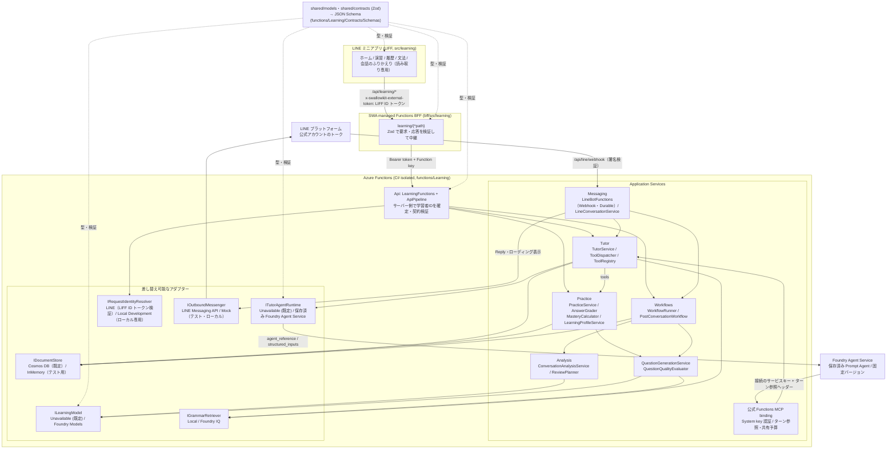
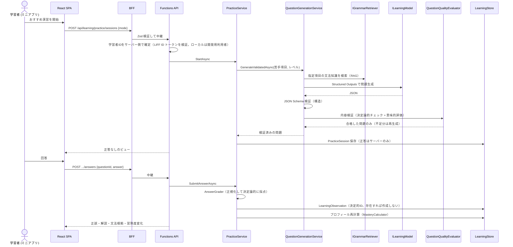
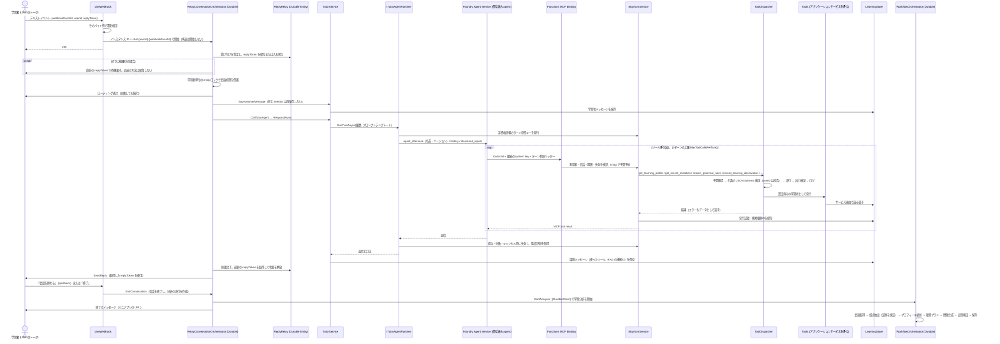
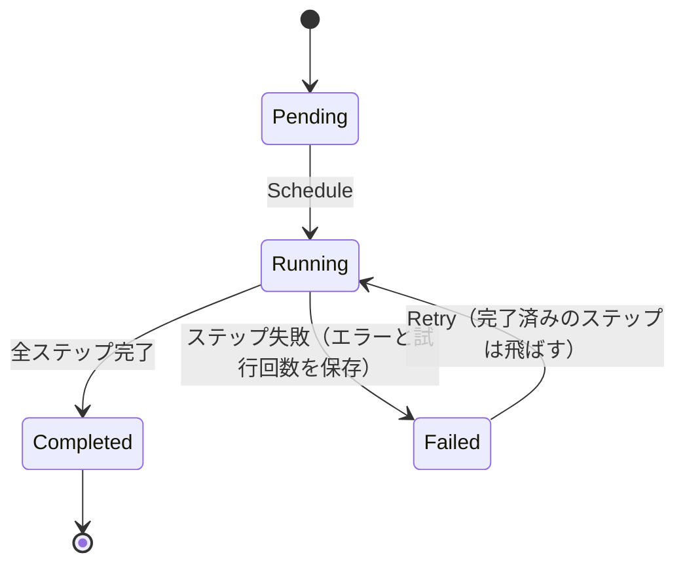

# アーキテクチャ

LINE ミニアプリ（問題演習）と Messaging API Bot（AI 講師との会話）を組み合わせた外国語学習サービスです。
SwallowKit が生成した構成（React + Vite SPA / SWA managed Functions の BFF / C# の standalone Azure Functions / 共有 Zod スキーマ）を使っています。SwallowKit のバージョンは `2.0.0` です。

## 全体構成

[Azure SVG アイコン付き構成図](../public/architecture/index.html) と
[Mermaid ソース](../public/architecture/overview.mmd) を参照できます。
アプリ起動中は <http://localhost:4280/architecture/> で表示できます。
表示ページは Mermaid 11.12.0 を CDN から読み込むため、ネット接続が必要です。
アイコン本体は [MS Icons](https://msicons.com/) から取得して同梱し、
製品名を併記しています（[出典・利用条件](../public/architecture/icons/ATTRIBUTION.md)）。
「SVG を保存」はアイコンを埋め込んだ単独 SVG を保存します。
下の図は内部サービスの責務を示します。

### 責務の分離

| レイヤー | 置き場所 | 責務 |
| --- | --- | --- |
| UI | `src/learning/` | 表示と操作のみ。データはすべて API から取得し、業務ロジックや正答は持たない |
| BFF | `bff/src/learning/index.ts` | ルート表に従い、共有 Zod スキーマで要求と応答を検証して中継する。業務ロジックとユーザーIDは扱わない |
| API | `functions/Learning/Api/` | 認証コンテキストの解決、要求と応答の契約検証（JSON Schema）、エラーの HTTP への変換 |
| アプリケーションサービス | `functions/Learning/{Practice,Tutor,Analysis,Workflows,Messaging}` | ドメインロジック。AI SDK には直接依存しない |
| アダプター | `functions/Learning/{Ai,Knowledge,Persistence,Identity}` | 未接続エラー、Foundry、DB から読み込んだ文法検索、Cosmos の実装 |
| 契約 | `shared/models/`, `shared/contracts/` | 正本（Zod）。`pnpm run contracts:export` で JSON Schema に書き出し、C# 側に埋め込む |

### 設計判断

1. **管理マスターには Scaffold、学習者データにはカスタム API を使います**
   - 文法・問題・講師は、管理者限定の標準 CRUD を SwallowKit の scaffold で生成します。`authPolicy` は GitHub の SWA スキームと `administrator` ロールを要求する `adminOnly` です。
   - 学習者データ（プロフィール、観測、演習、会話、復習プラン、ワークフロー）はすべてユーザー単位です。生成 CRUD は所有者で絞り込まないため、これらには学習者を認証して対象を制限するカスタム API を使います。
   - 採点・会話・習熟度更新などの業務操作はカスタムエンドポイントに置き、検証済み LINE の主体から絞り込みキーを導きます。LIFF 未設定のローカル開発では固定の開発ユーザーを使います。
   - 保存先は本番で Azure Cosmos DB、ローカルで Cosmos DB Emulator です。シードは SwallowKit の `dev --seed-env` で投入し、リクエスト処理では投入しません。
   - モデルは `shared/models/*.ts` が正本です（`id` 必須、`createdAt` / `updatedAt` 任意）。マスターは `/language`、学習者データは各モデルの所有者キーでパーティションを分けます。
2. **契約の二重管理を避けています**
   - C# のレコードは手書きですが、Zod から書き出した JSON Schema を実行時と単体テストの両方で検証しています。どちらか一方だけを変更すると、`contracts` チェックか契約テストで検出されます。
   - 対象は次のとおりです。
     - API の要求と応答（ApiPipeline）
     - 保存ドキュメント（テスト）
     - Structured Outputs（StructuredOutput.Parse）
     - ツール引数と出力（ToolDispatcher）
3. **AI の判断と、決定論的な更新を分けています**
   - 採点：`AnswerGrader` が、保存済みの正答と明示的な正規化ルールで判定します。
   - 習熟度：`MasteryCalculator` が、観測結果を順に再生して計算するルールベースの投影です。
   - AI が出すのは観測の「候補」だけです。証拠（学習者の発言の一部）が実在することをアプリケーションが確かめてから採用します。
   - 観測には `certainty` を付け、`deterministic`（誤答から確定）と `ai-inferred`（AI の推定）を区別します。AI の推定は重みを下げて習熟度に反映します（`0.6 × confidence`）。
4. **冪等性**
   - 観測 ID、演習セッション ID、復習プラン ID、ワークフロー実行 ID は、発生源から決定的に作ります。保存は `TryCreate`（存在しなければ作成）です。
   - 同じ回答、同じ会話イベント、終了処理の再実行、ツールとワークフローの両方による同じ指摘の記録が、重複して数えられることはありません。
5. **AI の接続設定とエラー処理**
   - 接続未設定時の AI 呼び出しは `503 / ai-not-configured` を返します。分析ワークフローでは失敗状態を記録します。
   - Foundry モードの接続設定が欠けている場合は、バックエンドの起動時にエラーになります。
   - `/api/learning/status` で接続設定の状態を確認できます。
6. **参照マスターも Cosmos DB を使います**
   - `ReferenceDataLoader` が最初の認証済み学習 API リクエスト、または MCP ツール呼び出しで `GrammarTopics` / `TutorProfiles` / `SampleQuestions` を読み、共有スキーマと参照整合性を検証します。成功した読み込みはキャッシュし、その後の変更反映にはバックエンドの再起動が必要です。
   - 空・不正なデータや DB 接続失敗では学習 API が `503 / reference-data-unavailable` を返し、次のリクエストで再試行します。
   - シードの生成元は `tools/SeedData/Data`、投入用配列は `dev-seeds/<環境名>` に置きます。プロンプトのテンプレートと JSON Schema は Functions に埋め込みます。

## 問題演習のシーケンス

## AI 講師（Tool Calling）のシーケンス

## 学習分析ワークフロー

| ステップ | 処理 | 出力（再開に必要な情報） |
| --- | --- | --- |
| load-conversation | 会話の取得と終了確認 | 発話数 |
| extract-observations | `ConversationAnalysisService`（モデル出力 → 証拠の検証） | 採用した観測と却下した観測 |
| update-profile | 観測を冪等に記録し、習熟度を再計算 | 作成数と重複数 |
| plan-review | `ReviewPlanner`（会話の誤り + 長期的な苦手） | reviewPlanId と topicIds |
| generate-questions | 演習と同じ `QuestionGenerationService` | 候補の問題 |
| validate-questions | `QuestionQualityEvaluator`（不合格分は再生成） | 合格した問題 |
| save-practice-session | 復習セッションを保存し、プランにリンク | practiceSessionId |

ワークフローの本体（`IWorkflowDefinition` / `IWorkflowStep`）と、ホスティング（`IWorkflowScheduler`）は分けてあります。
Function App では `DurableWorkflowScheduler` が `WorkflowOrchestrator` を開始し、各 step を Durable Functions のアクティビティとして実行します。
各 step の状態は画面の進捗表示と再実行のため `WorkflowRun` にも保存します。テストとオフラインのシード生成は `InProcessWorkflowScheduler` で同じ step を同期実行します。

## データモデル（`shared/models`）

| モデル | パーティション | 説明 |
| --- | --- | --- |
| LearningProfile | /userId | レベル、目標、`masteryByTopic`、苦手と得意。観測から計算した投影 |
| LearningObservation | /userId | 演習や会話からの観測。`certainty`、`confidence`、`evidence`、発生源の ID を持つ |
| PracticeSession（PracticeQuestion を内包） | /userId | 問題（正答と検証結果を含む）、回答、サマリー、生成元（学習者・ワークフロー・ツール） |
| TutorSession（TutorMessage を内包） | /userId | 会話、訂正、ツール呼び出しの記録、RAG の根拠 ID、分析ワークフローの ID |
| ReviewPlan | /userId | 優先度付きの復習項目（理由と根拠となる観測 ID）と、関連する演習 |
| WorkflowRun | /userId | 状態、ステップごとの試行回数、出力、エラー |
| GrammarTopic | /language | 文法ナレッジ（マスターデータ、監修状態つき） |
| TutorProfile | /language | 講師キャラクター（プロンプトテンプレート ID、訂正方針） |
| SampleQuestion | /language | 問題生成の参照サンプルと、演習で出題する公開済み問題。文法・ルールへの参照を持つ |
| ProcessedEvent | /userId | Webhook イベントの処理状態と重複処理の制御 |
| TutorToolTurn | /userId | MCP のターン参照、期限、ツール実行予算と監査 |

すべての文書が `schemaVersion` を持ちます。`createdAt` と `updatedAt` はサーバーが設定します。

## Observability

- `LearningTelemetry`：`ILogger` の構造化イベントと `ActivitySource("LineLanguageLearn.Learning")` で、次の情報を記録します。
  - AI 呼び出し（プロバイダー、モデル、処理時間、結果）
  - ツール呼び出し
  - RAG のヒット ID
  - 問題評価の結果
  - ワークフローのステップ
  - 却下した AI 出力
- 学習者の発言やプロンプトの本文はログに出しません。
- 会話ごとのツール呼び出し履歴と RAG の根拠 ID は `TutorMessage` に、問題の生成元と評価結果は `PracticeQuestion` に保存します。
- Azure 上では、Application Insights に `ILogger` の出力が流れます。`ActivitySource` を使ったトレースの収集には OpenTelemetry 等の exporter の設定が必要です。
