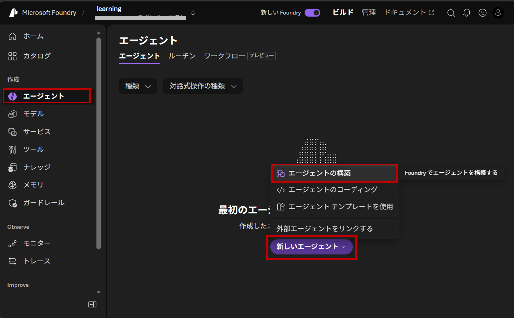
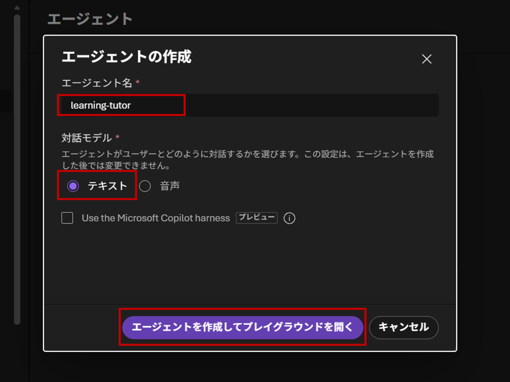
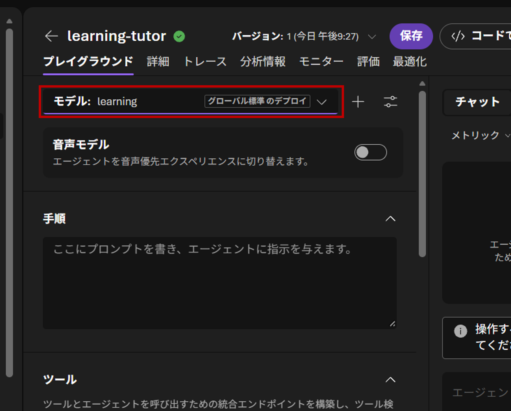
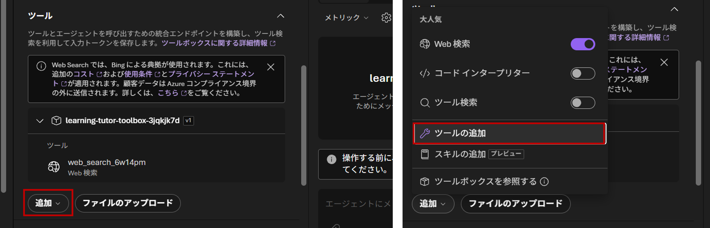
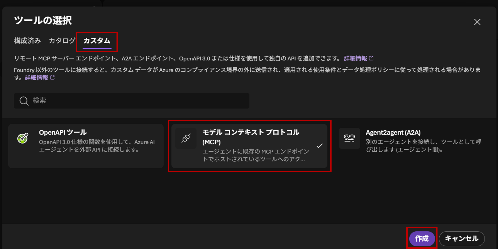
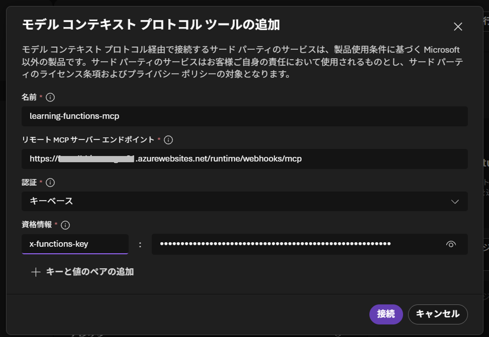

# Foundry の講師と MCP の設定

[README](../README.md) / 前：[初期シード投入](cloud-seed-initialization.md) / 次：[動作確認](real-device-test.md)

初期 provision により Foundry アカウント、learning プロジェクト、learning モデルと Functions の実行権限を作成します。
講師の指示・MCP 接続・保存バージョンはここで登録します。モデル生成とエージェント実行の基盤を Azure に任せ、教え方とツールの範囲をアプリで設計します。

## 1. 接続先を確認

Azure ポータルで対象の Foundry プロジェクト `learning` の **API エンドポイント** を控えます。
API endpoint はモデルの endpoint と異なり、末尾に `/api/projects/learning` が付きます。画面の URL 全体をコピーします。

MCP URL は `https://<Functions の実ドメイン>/runtime/webhooks/mcp` です。
Function App → 関数 → アプリ キー の **System keys** から `mcp_extension` を取得します。
master key や BFF のキーで代用しません。キーがないときは MCP 関数の配備・起動を確認します。

## 2. Foundry に接続を作る

[Foundry ポータル](https://ai.azure.com/)で `learning` プロジェクトを開き、エージェントを新規作成します。




名前を `learning-tutor`、対話モデルを `テキスト` にして作成します。




作成されたら、モデルを `learning` にします。




次に、ツール → 追加 → ツールの追加 → カスタム → Model Context Protocol (MCP) で接続を追加します。





下記の通り入力します。

| 項目 | 設定 |
| --- | --- |
| 接続名 | `learning-functions-mcp` |
| サーバー URL | 手順 1 の MCP URL |
| 認証 | Key-based |
| 資格情報のヘッダー | `x-functions-key` |
| 資格情報の値 | `mcp_extension` の値 |



画面は変わることがあります。[公式の Functions MCP 接続手順](https://learn.microsoft.com/azure/azure-functions/functions-mcp-foundry-tools#add-your-mcp-server)も参照してください。


## 3. 指示と構造化入力を含むバージョンを登録

以下のコマンドで、手順 2 で作成した `learning-tutor` に、講師の指示・構造化入力・MCP ツールの定義をまとめて設定します。構造化入力には講師名や学習レベル、MCP の動的ヘッダーに渡す `turnReference` を含みます。GUI で接続を準備し、このコマンドでアプリが期待する定義を保存する流れです。
GUI だけで同じ定義をすべて設定し、保存バージョンまで作成済みなら、このコマンドは省略できます。実行すると、対象エージェントの定義はリポジトリの内容で更新されます。
[登録用 JSON](foundry-tutor-agent.json)には六ツールの allowlist と入力宣言があります。
公式の [構造化入力と MCP](https://learn.microsoft.com/azure/foundry/agents/how-to/structured-inputs#use-structured-inputs-with-mcp-servers) と [エージェント更新 API](https://learn.microsoft.com/en-us/rest/api/microsoft-foundry/aiproject#agents---update-agent) に基づきます。

Codespaces のリポジトリ直下のターミナルで実行します。プレースホルダーを自分の値に置き換えてください。定義に変更があれば新しい保存バージョンが作成され、変更がなければ既存のバージョンが返ります。
キーをこのコードに貼る必要はありません。
`<…>` は括弧も含めて自分の値に置き換えます。
実行前に `az account show --query "{name:name,id:id}" -o table` で対象契約を確認します。

### zsh / Bash

プレースホルダー 2 項目を書き換えて、`node` の行から最後の `NODE` までをまとめて実行します。

```sh
node --input-type=module <<'NODE'
import { readFileSync } from 'node:fs';
import { execFileSync } from 'node:child_process';

const projectEndpoint = 'https://<Foundry のアカウント>.services.ai.azure.com/api/projects/learning';
const mcpUrl = 'https://<Functions の実ドメイン>/runtime/webhooks/mcp';
const connectionName = 'learning-functions-mcp';
const agent = JSON.parse(readFileSync('docs/foundry-tutor-agent.json', 'utf8'));
agent.definition.instructions = readFileSync('functions/Learning/Ai/Prompts/tutor.it-giulia.system.md', 'utf8');
agent.definition.tools[0].server_url = mcpUrl;
agent.definition.tools[0].project_connection_id = connectionName;
const token = execFileSync('az', [
  'account', 'get-access-token', '--resource', 'https://ai.azure.com',
  '--query', 'accessToken', '-o', 'tsv',
], { encoding: 'utf8' }).trim();
const response = await fetch(`${projectEndpoint.replace(/\/$/, '')}/agents/${encodeURIComponent(agent.name)}?api-version=v1`, {
  method: 'POST',
  headers: { Authorization: `Bearer ${token}`, 'Content-Type': 'application/json' },
  body: JSON.stringify({ definition: agent.definition }),
});
if (!response.ok) {
  throw new Error(`エージェント更新失敗: HTTP ${response.status}\n${await response.text()}`);
}
const saved = await response.json();
console.log({ name: saved.name, version: saved.version ?? saved.versions?.latest?.version });
NODE
```

<details>
<summary>PowerShell を使う場合</summary>


```powershell
$projectEndpoint = "https://<Foundry のアカウント>.services.ai.azure.com/api/projects/learning"
$mcpUrl = "https://<Functions の実ドメイン>/runtime/webhooks/mcp"
$connectionName = "learning-functions-mcp"
$agent = Get-Content -Raw -Encoding utf8 docs/foundry-tutor-agent.json | ConvertFrom-Json
$agent.definition | Add-Member -NotePropertyName instructions -NotePropertyValue (Get-Content -Raw -Encoding utf8 functions/Learning/Ai/Prompts/tutor.it-giulia.system.md) -Force
$agent.definition.tools[0].server_url = $mcpUrl
$agent.definition.tools[0].project_connection_id = $connectionName
$token = az account get-access-token --resource https://ai.azure.com --query accessToken -o tsv
if ($LASTEXITCODE -ne 0) { throw "Azure トークンを取得できませんでした" }
try {
  $headers = @{ Authorization = "Bearer $token" }
  $agentName = [Uri]::EscapeDataString($agent.name)
  $uri = "$($projectEndpoint.TrimEnd('/'))/agents/${agentName}?api-version=v1"
  $body = @{ definition = $agent.definition } | ConvertTo-Json -Depth 30
  $saved = Invoke-RestMethod -Method Post -Uri $uri -Headers $headers -ContentType "application/json; charset=utf-8" -Body ([Text.Encoding]::UTF8.GetBytes($body))
  $version = if ($saved.version) { $saved.version } else { $saved.versions.latest.version }
  [PSCustomObject]@{ name = $saved.name; version = $version }
} catch {
  throw "エージェント更新失敗: $($_.Exception.Message)`n$($_.ErrorDetails.Message)"
} finally {
  $token = $null
  $headers = $null
}
```

</details>

### 登録結果の確認

返却されたバージョンを控え、Foundry でその版を開いて確認します。レスポンス形式によって版が直下に表示されない場合は保存された版の詳細から取得します。
指示の `{{tutorName}}` 等は置き換えず残します。MCP ヘッダーは `X-Learning-Context: {{turnReference}}` です。
これはバックエンドが発行する短命の参照で、LINE トークンや利用者 ID は入力に渡しません。
接続に保存したシステムキーと、参照による対象データの制限を組み合わせます。

登録されるツールは get_learning_profile、get_recent_mistakes、search_grammar_rules、record_learning_observation、create_practice_session、get_review_plan の六つ。
これらは承認不要に設定しますが、サーバー側で対象学習者・期限・回数・入力を検証します。
Playground には有効なターン参照がないため、学習ツールの実行はアプリから確認します。

## 4. 固定バージョンを有効化

Function App → 環境変数 → アプリ設定 で以下を追加・確認し、「適用」をクリックします。

| 設定 | 値 |
| --- | --- |
| `Learning__TutorAgent` | `FoundryAgentService` |
| `Learning__Foundry__ProjectEndpoint` | 対象プロジェクトの API endpoint（設定済み） |
| `Learning__Foundry__AgentName` | `learning-tutor`（設定済み） |
| `Learning__Foundry__AgentVersion` | 手順 3 で保存した固定の版番号（手順通りなら `3` になります） |

## 5. 動作を確認する

設定を保存したら [Azure / LINE での動作確認](real-device-test.md)へ進みます。

## 困ったとき

| 症状 | 確認 |
| --- | --- |
| 登録 API が 403 | 作業者のプロジェクト権限と az login のテナント |
| 登録 API が 409 | 古いコマンドの新規作成 API（`POST /agents`）を使っていないか確認。手順 2 で作成済みのため、手順 3 の更新 API（`POST /agents/{name}`）を使う。更新でも失敗する場合は表示されたエラー本文を確認 |
| 登録 API が 404 | 手順 2 で `learning-tutor` を作成済みか、Project endpoint が同じプロジェクトを指しているか確認 |
| アプリの Agent API が 403 | Functions identity の Foundry Agent Consumer、Project endpoint |
| MCP が 401 | 接続の URL / x-functions-key / mcp_extension |
| MCP が 404 | コード配備と MCP extension の起動 |
| invalid-tool-context | 動的ヘッダー、構造化入力、期限。Playground 単独では拒否が正常 |
| モデル・版が見つからない | deployment learning、保存版、対象プロジェクト |
