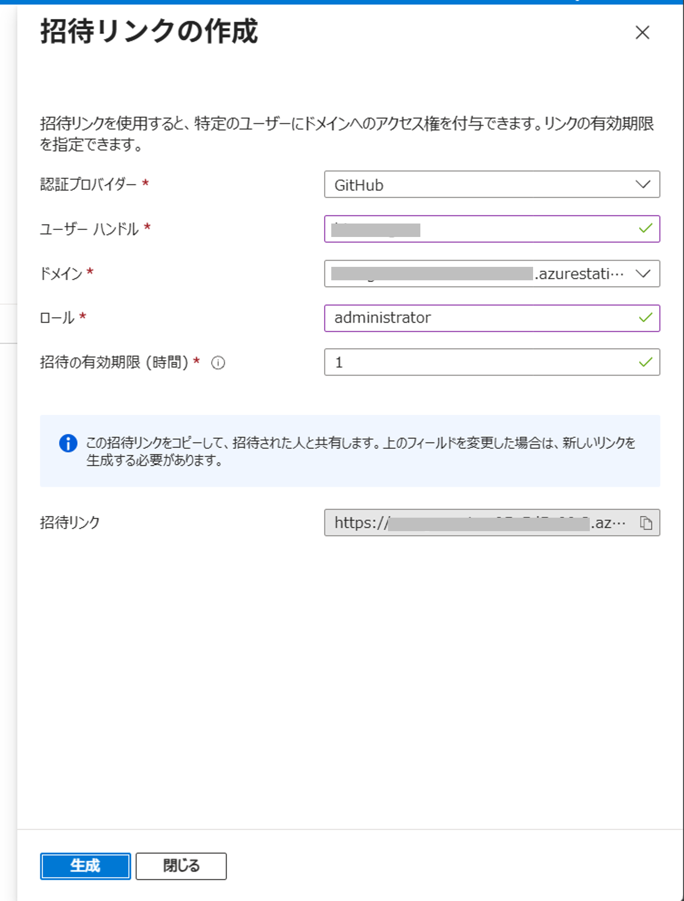

# GitHub Actions でコードを配備する

[README](../README.md) / 前：[LINE の設定](line-setup.md) / 次：[初期シード投入](cloud-seed-initialization.md)

LINE のチャネル設定と GitHub Variables の登録を済ませたら、provision 直後に登録した配備用 Secrets を確認し、画面・BFF と独立 Functions を Azure に配備します。

## 1. GitHub の配備用 Secrets

[Azure 構築時の Secrets 登録手順](azure-deployment.md#provision-完了直後github-actions-の-secrets-を登録する)で登録した `AZURE_STATIC_WEB_APPS_API_TOKEN`、`AZURE_FUNCTIONAPP_NAME`、`AZURE_FUNCTIONAPP_PUBLISH_PROFILE` が、自分のリポジトリの **Settings → Secrets and variables → Actions → Secrets** にあることを確認します。未登録なら、リンク先の手順で 3 件を登録してから進んでください。

## 2. 配備ワークフローを実行する

GitHub **Actions → 対象ワークフロー → Run workflow → Branch: main → Run workflow** で、次の両方を実行します。

| ワークフロー | 配備先 | 成功の確認 |
| --- | --- | --- |
| **Deploy Azure Functions** | 独立 Functions | Publish / Deploy 成功、Functions 一覧に学習 API・LINE・MCP の関数 |
| **Deploy React SPA and managed BFF** | SWA | Build / Deploy 成功、SWA の URL に `/miniapp` を付けると画面が表示される |

`main` への push でもパス条件に該当すれば自動実行します。共有モデル変更は両方が対象です。
PR や main 以外からの手動実行では本番配備しません。LIFF の公開変数を変更したら SPA/BFF を再配備します。
Run workflow 後は実行一覧の新しい行を開き、ジョブをクリックして各ステップの緑のチェックを確認します。赤なら該当ステップのログを開きます。
Run workflow が出ない場合は自分のリポジトリの既定ブランチに YAML があることと、書き込み権限を確認します。[手動実行の公式手順](https://docs.github.com/ja/actions/how-tos/manage-workflow-runs/manually-run-a-workflow)

**画面と BFF は一緒に配信し、Durable / MCP を含む業務処理は独立 Functions で更新できます。**

## 3. 管理者を招待する

GitHub Actions のワークフローがどちらも成功したら、管理者は Azure ポータル → Static Web Apps の対象リソース → **Role management → Invite** で、プロバイダー `GitHub`、自身のアカウント、ロール `administrator` を指定して招待リンクを生成します。

招待リンクにアクセスし、「Grant Consent」をクリックします。その後、ミニアプリのリンクにリダイレクトされてしまいますが、直接 URL を編集し Static Web Apps のドメイン + `/admin` にアクセスすると、管理画面に入れます。管理画面については、[管理画面](admin.md)も参照してください。

配備と招待が完了したら [初期シード投入](cloud-seed-initialization.md)へ進みます。
